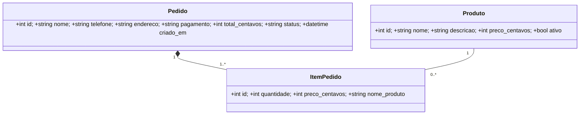
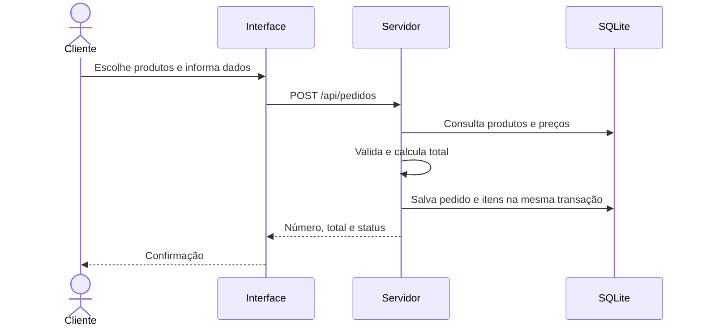

# Projeto Integrador II — Doce Encanto

Aluno: Luiz Henrique Oliveira dos Santos — RGM 33436037  
Base: atividade anterior realizada, que descreve uma loja gourmet de cupcakes com vendas online, pedidos, pagamentos digitais e entregas.

## 1. Objetivo e escopo

Permitir que um cliente escolha cupcakes, monte um pedido e informe dados de entrega; permitir à loja consultar os pedidos e alterar seu andamento. O protótipo é web e responsivo, para uso em telas de celular ou computador. O pagamento e a entrega são simulados; a aplicação não executa transações financeiras nem despacha produtos.

## 2. Requisitos e backlog

| ID | História de usuário / requisito | Prioridade | Situação |
|---|---|---|---|
| RF01 | Como cliente, quero ver os sabores, descrições e preços para escolher produtos. | Alta | Implementado |
| RF02 | Como cliente, quero adicionar e ajustar quantidades para compor meu pedido. | Alta | Implementado |
| RF03 | Como cliente, quero informar nome, telefone, endereço e modalidade de pagamento. | Alta | Implementado |
| RF04 | Como loja, quero registrar pedidos e itens para não perder as informações. | Alta | Implementado |
| RF05 | Como loja, quero consultar pedidos e atualizar o andamento. | Alta | Implementado |
| RF06 | Como cliente, quero pagar digitalmente e acompanhar uma entrega real. | Alta | Não implementado: somente simulação |
| RF07 | Como cliente, quero consultar o andamento com número e código do pedido. | Média | Implementado para novos pedidos; protótipo local sem autenticação no painel da loja |
| RNF01 | Interface legível e responsiva para telas pequenas e grandes. | Alta | Implementado, sujeito à avaliação em dispositivos reais |
| RNF02 | Persistir pedidos e garantir integridade referencial. | Alta | SQLite com chaves estrangeiras e restrições |
| RNF03 | Validar pedidos e calcular o total no servidor. | Alta | Implementado |
| RNF04 | Proteger dados e restringir acesso por usuário. | Alta | Não implementado; uso local de demonstração |

## 3. Casos de uso

**Realizar pedido** — Ator: cliente. Pré-condição: servidor ativo e produto disponível. Fluxo: selecionar produto; abrir sacola; definir quantidades; informar dados e pagamento; confirmar. O servidor valida campos e produtos, calcula o total, registra o pedido e devolve o número. Alternativas: carrinho vazio, dados incompletos ou produto inválido geram mensagem e não criam pedido. Pós-condição: pedido registrado com status Recebido.

**Gerenciar andamento** — Ator: loja. Pré-condição: pedido existente. Fluxo: abrir Pedidos da loja, selecionar um dos estados permitidos. O servidor salva o estado. Alternativas: pedido inexistente ou estado inválido são rejeitados. O protótipo não restringe transições entre estados.

## 4. Modelagem

### Classes e dados (Mermaid)

### Sequência de pedido

### Projeto lógico e físico

`produtos` 1:N `itens_pedido` N:1 `pedidos`. As tabelas são criadas pelo arquivo `schema.sql`; chaves estrangeiras, campos obrigatórios e verificações limitam valores. Nome e preço do produto são copiados no item para preservar o histórico quando um produto for alterado. Os valores monetários são inteiros em centavos, evitando arredondamento binário.

| Tabela | Campo | Tipo / significado |
|---|---|---|
| produtos | id | INTEGER, chave primária |
| produtos | nome, descricao, emoji | TEXT, identificação e apresentação |
| produtos | preco_centavos | INTEGER, preço unitário não negativo |
| produtos | ativo | INTEGER, 0 ou 1 |
| pedidos | id | INTEGER, chave primária |
| pedidos | nome, telefone, endereco | TEXT, dados informados para entrega |
| pedidos | pagamento | TEXT, Pix ou Cartão na entrega, ambos simulados |
| pedidos | total_centavos | INTEGER, soma calculada no servidor |
| pedidos | status | TEXT, Recebido, Em preparo, Saiu para entrega, Entregue ou Cancelado |
| pedidos | criado_em | TEXT, horário UTC gerado pelo SQLite |
| pedidos | codigo_acesso | TEXT, código para consulta do andamento de pedidos novos |
| itens_pedido | id | INTEGER, chave primária |
| itens_pedido | pedido_id, produto_id | INTEGER, chaves estrangeiras |
| itens_pedido | nome_produto, preco_centavos | TEXT e INTEGER, retrato do produto no pedido |
| itens_pedido | quantidade | INTEGER positivo |

## 5. Arquitetura

A interface HTML/CSS/JavaScript apresenta os dados e envia solicitações HTTP. `app.py` recebe requisições, valida dados e aplica as regras; SQLite armazena produtos, pedidos e itens. A separação se aproxima de MVC: interface como visão, rotas como controlador e funções SQL como camada de dados; não é uma implementação de framework MVC completo.

Rotas: `GET /api/produtos`, `POST /api/pedidos`, `POST /api/acompanhar`, `GET /api/pedidos` e `PATCH /api/pedidos/{id}`. Por padrão, o servidor usa `127.0.0.1`; a variável `CUPCAKE_HOST` permite configurar o acesso pela rede local. O arquivo de banco é criado automaticamente na inicialização.

## 6. Verificação e validação

Na pasta acadêmica Projeto Transdisciplinar, execute `py -3 -m unittest discover -s tests -v`. Os testes verificam listagem, gravação e recuperação de pedido, cálculo do total independente do valor enviado, mudança de status e rejeição de entradas inválidas. Usam banco temporário e não modificam o banco da loja. Os relatos de Fabricio, Bruna, Raissa, Keren e Rodrigo, datados de 10/11/2026, estão em RELATORIO_AVALIACOES.pdf. Não houve nova rodada de avaliação após as melhorias.

Roteiro manual: (1) abrir cardápio e conferir sabores; (2) adicionar duas unidades e conferir total; (3) tentar confirmar com campos vazios; (4) preencher dados fictícios e confirmar; (5) abrir Pedidos da loja e conferir itens e total; (6) alterar status, reiniciar o servidor e conferir persistência; (7) repetir em janela estreita. Registrar o resultado observado, data e ambiente quando executar.

## 7. Melhorias e revisão de 17/11/2026

Bruna sugeriu copiar o código do pedido; o botão já está disponível. A sugestão de Raissa resultou em campos separados para rua, número, bairro e complemento, com validação no servidor e complemento opcional. O endereço completo permanece no campo endereco do banco, preservando pedidos anteriores.

O acompanhamento apresenta etapas visuais com explicações, atendendo parcialmente à proposta de Keren. Notificações externas continuam pendentes. As informações de ingredientes e alergênicos sugeridas por Fabricio dependem de confirmação da loja. A autenticação sugerida por Rodrigo ainda não foi implementada.

Em 17/11/2026, o layout desktop recebeu ajustes de largura, alinhamento do catálogo, banner e formulários. As regras se aplicam somente acima de 760 px. A comparação em 390 px manteve as dimensões e os estilos verificados. As verificações em 768, 1024 e 1920 px não mostraram rolagem horizontal.

Os quatro testes automatizados passaram em 16/11/2026. Pagamentos e entregas permanecem simulados.
